# Phase 1 look: the landing page and the calculator

**Decision (issue #69, 2026-09-18):** both Phase 1 pages are set as **The Audited Statement**: the
calculator looks like the financial-statement page its numbers come from, and the landing page is
that statement's cover block. This note records the candidates compared, the chosen look at phone,
tablet and desktop widths in light and dark, where every required control and message lives, and
the token values the Tailwind ticket builds from.

The mock-ups are static HTML in [`mockups/`](mockups/): open
[`landing.html`](mockups/landing.html) and [`calculator.html`](mockups/calculator.html) in a browser
(`?theme=dark`, `?state=saved|modal|404|422|503`). The calculator mock-up computes the glossary
formula live so the numbers can be argued with. All figures are **illustrative**, for Apple Inc.,
and are marked so on every page.

## Candidates compared

Generated with the Impeccable design skill's direction round (seed `9389f387`), which deals a
random one of the author's own grounded candidates plus catalog challengers, so the choice is
made against real alternatives rather than the first idea. Each was judged against the roadmap
constraints (table with rows = inputs and columns = Bear / Base / Bull, base facts and the
figures-to date above, X as the headline, disclaimer under the output row and in the footer,
mobile-first, light and dark) and the anti-goals the product owner named: no broker-terminal look,
no generic SaaS template.

| Candidate | What it was | Verdict |
|---|---|---|
| **The Audited Statement** (chosen) | The calculator set like a 10-K statement page: rules, period-end date over the figures, negatives in parentheses, one blue-pencil accent for edits. | Meets every constraint; provenance is the aesthetic. |
| The Passage Chart (the roll's assignment) | A nautical chart: base facts on buff land, assumptions on water, three plotted bearings, "not for navigation" as the disclaimer. Every device functional, not decorative. | Viable and distinctive, but the name's literal reading; costume risk. Not chosen. |
| Civic Bureau Prospectus | Bone-white hairline bands, one violet accent, rendered ribbon. | Clear, but the polished form of the SaaS landing the brief ruled out. Not chosen. |
| Miura-fold sheet, deep-dive profile, character catalog, drum-machine step row, nixie gauze | Catalog challengers fused with Compass. | Declined on audience identification and table clarity; each donated one discipline (see below). |
| The category standard | White, near-black, blue, cards and tabs. | Offered as the plain exit; not taken. |

Disciplines kept from the declined challengers and built into the chosen look: an edit visibly
propagates to the output row (the changed rows tint for a beat); every numeral hangs on one
right-aligned rule per column; a scenario column is never split across widths; unit and source are
printed beside every field; outputs snap rather than animate-count, and all three scenarios are
always present.

**Why this one, in a sentence:** a reviewer sees a product that looks like its own evidence, and a
beginner reads where each figure came from before they change it.

## The landing page

A statement cover block: the title, a rule, one line on what Compass does, a units note, and the
ticker box as a ruled entry line with the one blue action. Sign in and register sit in the header
rule. The ticker box works signed out; submitting routes through sign in and on to the projection.
Below the fold, a marked-illustrative specimen of the output rows shows the mechanism.

| Phone (390) | Tablet (820) | Desktop (1440) |
|---|---|---|
| 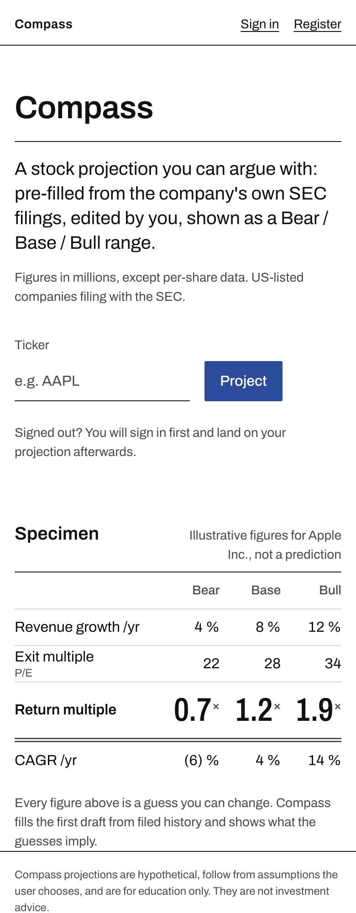 | 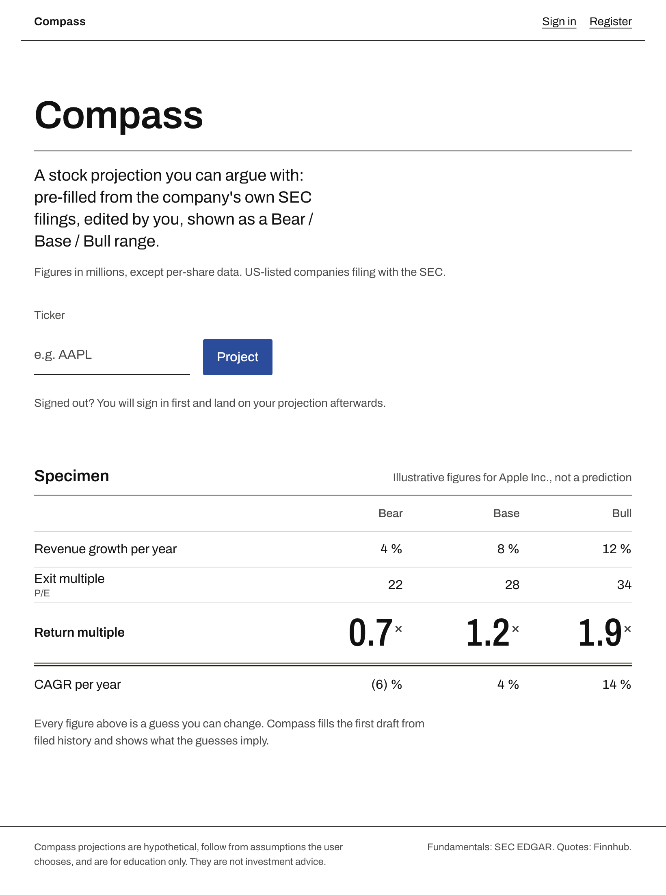 | 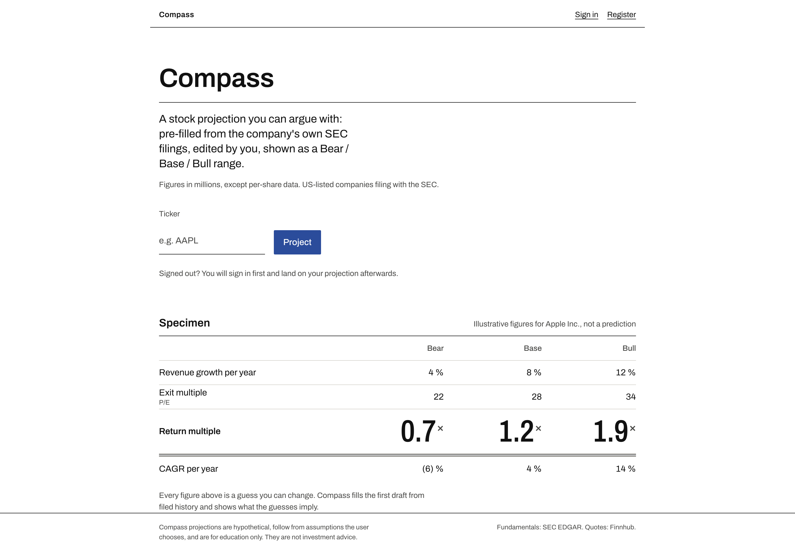 |
| 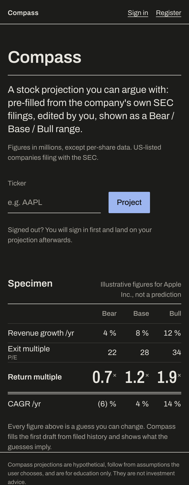 | 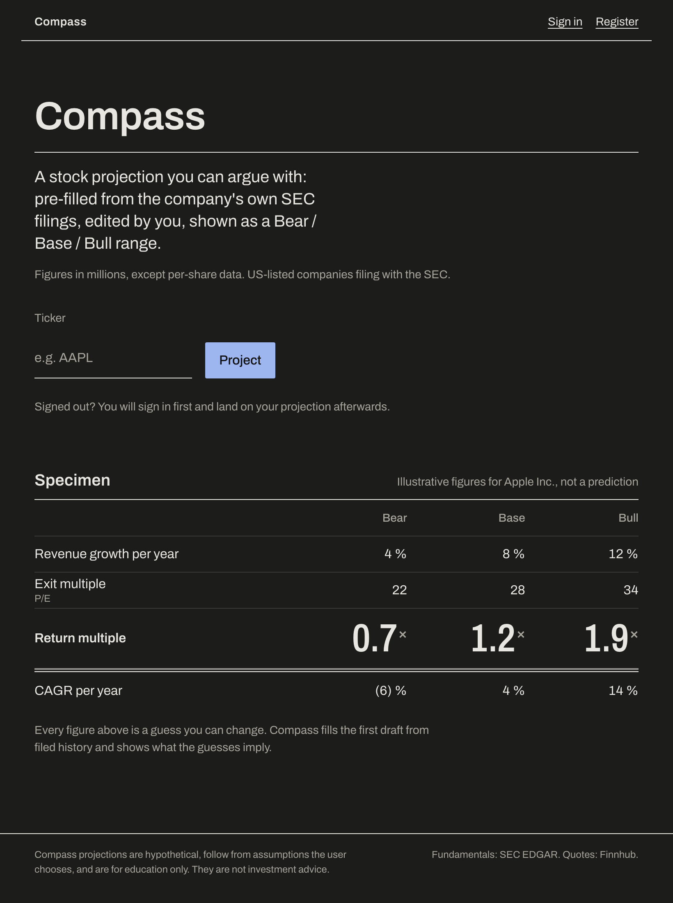 | 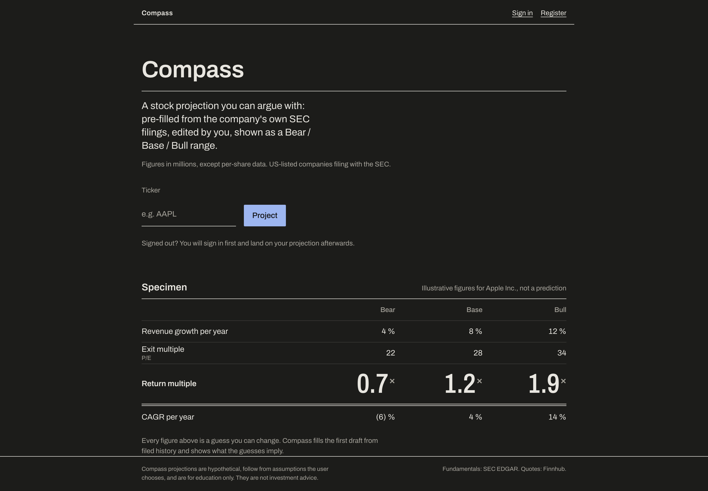 |

## The calculator

One statement, top to bottom: company and ticker as the heading; the figures-to date and both
source names on the line beneath; **Base facts** as opening lines in one column, each editable in
place; **Assumptions** as rows with Bear / Base / Bull columns, P/E or P/S chosen per column; a
single rule; **Return multiple (X)** as the total under a double rule, the largest numerals on the
page; CAGR and future share price beneath; the disclaimer as the footnote directly under them, and
again in the footer. Save (new) or Update (existing) below.

Figures look printed until touched. Hover shows a hairline, focus a blue-pencil underline, and an
edited figure turns blue. Outputs recompute on every keystroke and the output rows tint blue for a
beat so the chain from a guess to the total is visible. Negatives, including buybacks and a
negative CAGR, print in parentheses.

| Phone (390) | Tablet (820) | Desktop (1440) |
|---|---|---|
| 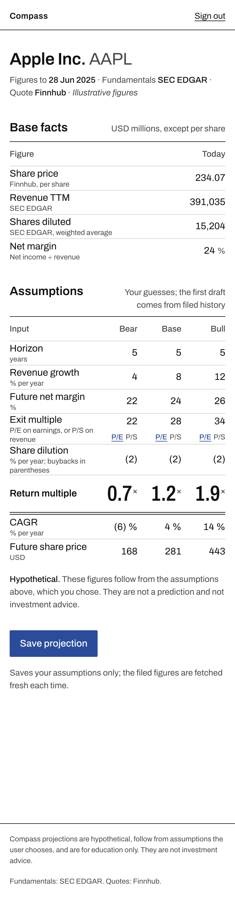 | 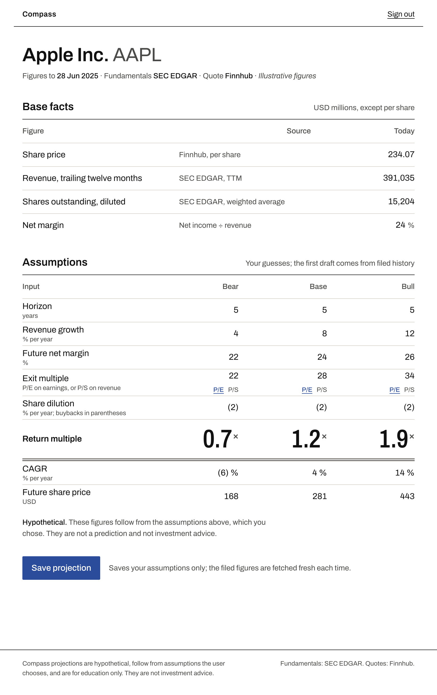 | 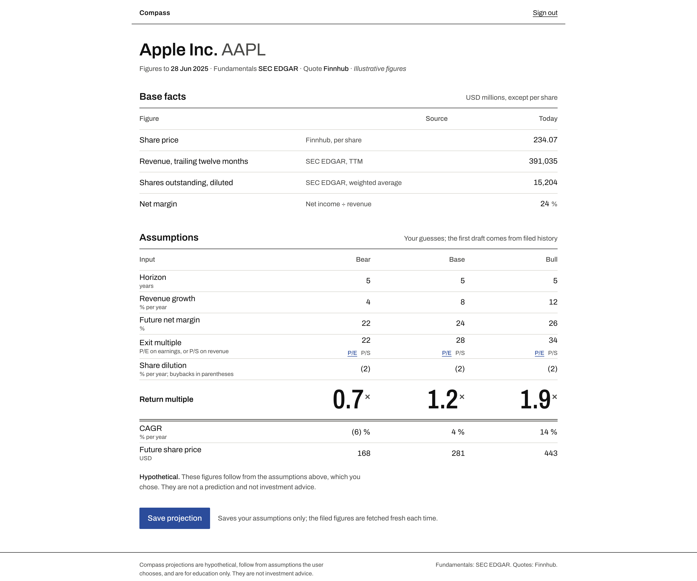 |
| 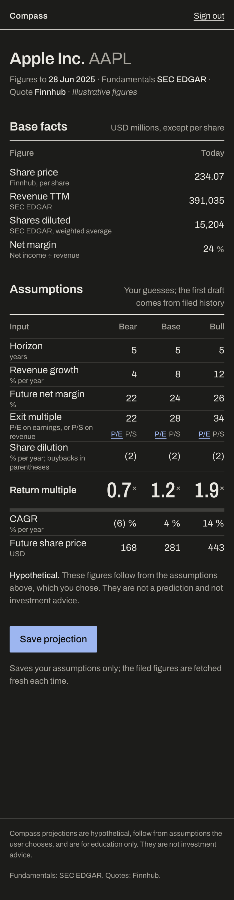 | 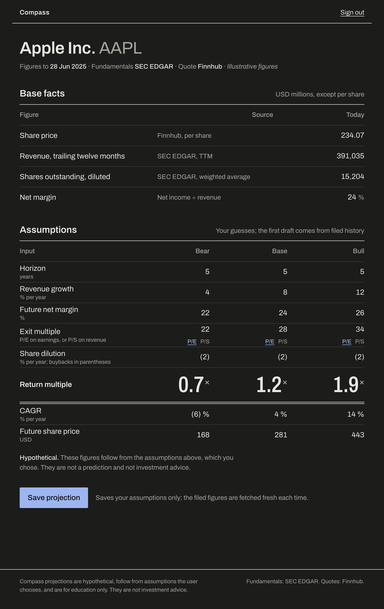 | 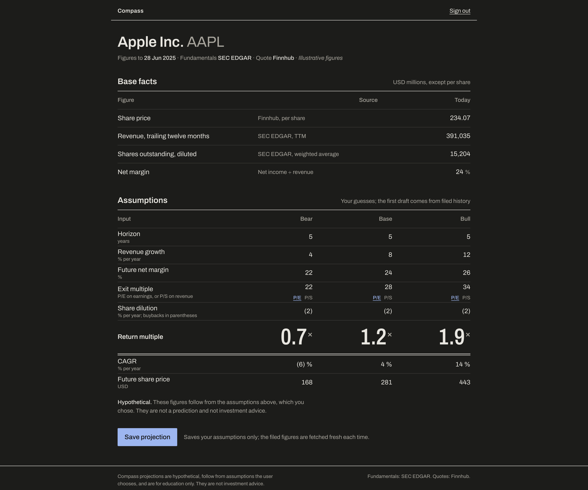 |

### How the three columns behave on a phone

**The table stays whole.** Per-scenario values are short (a year count, whole-number percents, a
multiple), so a label column plus three narrow numeric columns fits at 390px, as the phone capture
shows. Labels abbreviate below 480px the way a statement does ("Revenue TTM", "Shares diluted"),
and the source line moves under the label. Base facts are single-column and never compete with the
scenarios. No tabs, no one-scenario-at-a-time switch: the range is always on screen. Horizontal
scroll with a frozen label column is the overflow fallback only, and nothing in Phase 1's rows
needs it.

Tablet and desktop widen the same table; base facts gain a source column at 768px and up. Nothing
gains a sidebar or cards.

### Where the required things live

| Requirement | Home | Capture |
|---|---|---|
| Saved-data indicator | A blue-pencil line under the provenance line: "Your assumptions, saved 12 Sep 2026, over today's figures". | [saved](mockups/shots/calculator-phone-saved.png) |
| Reset to defaults | "Restate to defaults", a link beside the saved line. | [saved](mockups/shots/calculator-phone-saved.png) |
| Save vs Update | Save projection (new) or Update projection (existing) as the one filled action under the footnote. | [fresh](mockups/shots/calculator-phone-light.png), [saved](mockups/shots/calculator-phone-saved.png) |
| Confirmation modal | Update opens a statement-note dialog: "Replace your saved projection for AAPL?" with Keep saved and Replace. | [modal](mockups/shots/calculator-phone-modal.png) |
| 404 unknown ticker | A statement note above Base facts: "No SEC filings found for XYZQ." The form stays editable with empty figures. | [404](mockups/shots/calculator-phone-404.png) |
| 422 unsupported filer | The same note with the plain reason: "TSM files a 20-F, which Compass cannot read." | [422](mockups/shots/calculator-phone-422.png) |
| 503 fundamentals down | The same note: "SEC EDGAR could not be reached just now", with a try-again link; saved assumptions still load. | [503](mockups/shots/calculator-phone-503.png) |
| Null price (partial 200) | The share-price figure prints empty with its source line; everything else fills. Not captured separately. | |
| Disclaimer | The footnote under the output rows and the footer of every page. | every capture |

## Token values

The source of truth is [`mockups/tokens.css`](mockups/tokens.css); the Tailwind ticket should
read its custom properties into the theme rather than retype them. Summary:

**Colour, light (statement paper)**

| Role | Value | Use |
|---|---|---|
| paper | `#FFFFFF` | page ground |
| paper-2 | `#F6F5F1` | caption bands, hover |
| ink | `#111111` | text, figures |
| ink-2 | `#4A4A48` | units, sources, dates (8.6:1) |
| rule | `#1F1F1F` | statement rules |
| hairline | `#D8D6CF` | row rules |
| pencil | `#2B4C9B` | edits, links, the primary action (7.3:1) |
| pencil-tint | `#E8EEF9` | changed-row tint, selection |

**Colour, dark (the microfiche negative)**

| Role | Value |
|---|---|
| paper | `#1C1C1A` |
| paper-2 | `#242422` |
| ink | `#E8E6E0` |
| ink-2 | `#A7A49C` (6.6:1) |
| rule | `#E8E6E0` |
| hairline | `#3A3936` |
| pencil | `#9DB6F0` (8.6:1) |
| pencil-tint | `#26304A` |

Dark follows `prefers-color-scheme` and a `data-theme` override; both themes meet WCAG 2.2 AA for
every text pair above.

**Spacing:** a 4px base scale (4, 8, 12, 16, 24, 32, 48, 64) with a table row rhythm of 40px on
phones and 44px from tablet up; the statement column is 40rem, 48rem and 56rem at the three widths.
Rules are 1px; the double rule is two 1px lines 4px apart. No shadows, no radii above 2px.

**Numeric type:** one family, [Archivo](https://fonts.google.com/specimen/Archivo) (variable, with
a width axis), so copy and totals share a voice. Body at normal width, 16px / 1.5; labels and notes
14px; footnotes 12px. **Tabular lining figures everywhere** (`font-variant-numeric: tabular-nums
lining-nums`) so columns align. The X totals are set condensed (width 75), weight 600, at 36px on
phones, 48px on tablets and 56px on desktop, with a small "×" suffix in the secondary ink.
Negatives in parentheses, never a minus sign. Whole-number percents and millions in the UI, as the
roadmap requires. Self-hosting the face is the token ticket's job; the mock-ups load it from Google
Fonts.

## Open items

- Whether blue pencil is the right single accent. It is the auditor's colour and reads as "edited"
  without explanation; the alternative would be a red-pencil accent, which was not built because it
  drifts toward the signal-red of every finance app.
- The Phase 2 education page inherits this world unchanged; it is a Read surface and the statement's
  notes grammar carries it.

## Regenerating the captures

```bash
docs/design/mockups/shoot.sh
```

Needs Google Chrome; captures at 2x through `frame.html` because headless Chrome will not open a
window narrower than 500px.
